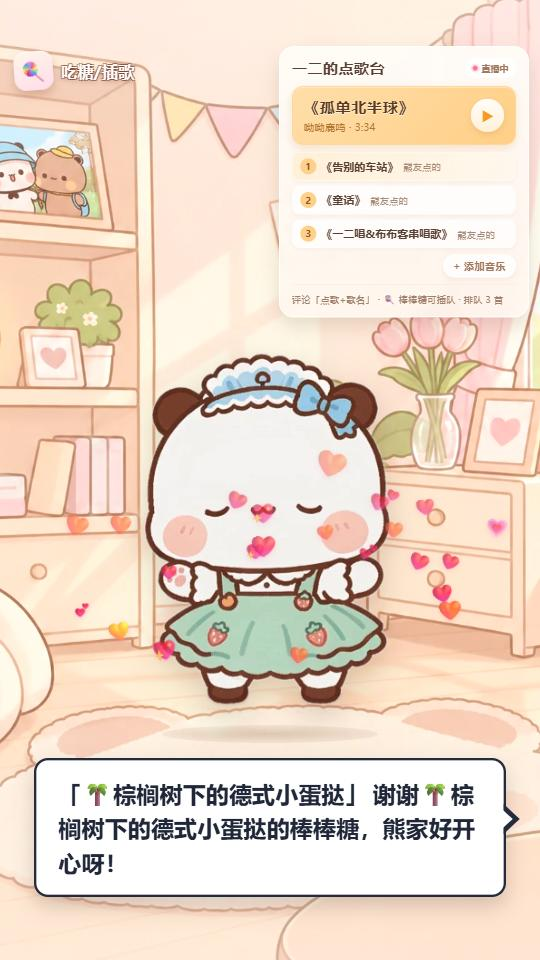
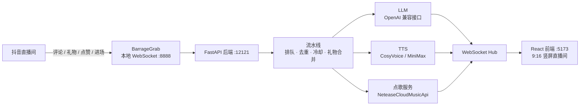

<div align="center">
  
</div>

<div align="center">


**把抖音直播间变成一场 AI 虚拟主播的实时互动**

弹幕抓取 → 人设对话 → 语音合成 → 点歌 / 礼物 / 点赞 / 表情包，全链路本地可跑。

配套默认角色「一二」，换成自己的角色只需改一个目录。

</div>

---

## 效果预览

| 竖屏直播间 | 点赞爱心雨 |
|:---:|:---:|
|  |  |
| 1080×1920 竖屏画布，语音气泡跟随音频逐字显示，右侧是点歌台 | 点赞触发爱心雨，礼物触发对应表情包与专属道谢 |

## 它能做什么

| 能力 | 说明 |
| --- | --- |
| **弹幕实时接入** | 通过 [BarrageGrab](https://github.com/aucephine/BarrageGrab) 的本地 WebSocket 接入抖音直播间的评论、礼物、点赞、进场；支持断线重连和 45 秒无消息超时重连 |
| **人设化对话** | 任意 OpenAI Chat Completions 兼容服务（Ollama / DeepSeek / 豆包方舟 / vLLM），角色人设、口癖、输出规则全部写在角色包里 |
| **语音播报** | 自部署 [CosyVoice2](https://github.com/FunAudioLLM/CosyVoice) 零样本音色克隆，或 MiniMax 云端 TTS；文字气泡跟随真实音频进度逐字显示，浏览器拦截自动播放时提供「点击启用声音」 |
| **礼物互动** | 连送礼物按到达时间合并（5 秒窗口，直到连送结束），只道谢一次且数量取最大值；礼物名映射到对应表情包，未命中播默认感谢图 |
| **点赞 / 进场** | 点赞触发爱心雨 + 限流语音道谢；进场弹欢迎条，语音欢迎有独立冷却，避免真实直播间刷屏 |
| **弹幕点歌** | 评论「点歌 xxx」→ 本地曲库模糊匹配 → 网易云搜索解析 → 下载缓存 → 排队播放；同一观众冷却、单曲时长限制、缓存 LRU 淘汰，主播说话时自动压低伴奏 |
| **关键词表情包** | 弹幕命中关键词（如「跳舞」「杂技」）时播放对应 GIF，像收到礼物一样推给前端 |
| **竖屏直播画面** | 固定 1080×1920 设计画布整体等比缩放，适配任意窗口；`?chat=1` 可打开弹幕调试栏 |
| **调试接口** | 不接真实直播间也能用 `/api/dev/inject`、`/api/dev/say` 注入消息，快速验证整条链路 |

## 架构



## 快速开始

> 核心链路在 Windows 上开箱即用（BarrageGrab 与启动脚本是 Windows 版）。其他系统可以替换弹幕源，或先用 `fake` 假数据体验。

### 0. 环境要求

| 依赖 | 版本 / 说明 |
| --- | --- |
| Python | 3.10+ |
| Node.js | 18+（前端与网易云 API） |
| BarrageGrab | 可选，真实抖音弹幕源；仓库 `tools/BarrageGrab/` 内附运行包，也可从上游自行下载 |
| LLM | 可选，本地 Ollama 或任意 OpenAI 兼容 API |
| TTS | 可选，MiniMax 云端 Key，或自部署 CosyVoice2（见 [scripts/README.md](scripts/README.md)） |

### 1. 后端

```bash
git clone https://github.com/<your-name>/live-mascot.git
cd live-mascot

python -m venv .venv
.venv\Scripts\activate          # macOS/Linux: source .venv/bin/activate
pip install -r backend/requirements.txt

copy .env.example .env          # macOS/Linux: cp .env.example .env
```

编辑 `backend/config.yaml` 选择弹幕源、LLM 与 TTS，然后启动：

```bash
start_backend.bat
# 或者手动：
# .venv\Scripts\python.exe -m uvicorn backend.main:app --host 0.0.0.0 --port 12121
```

健康检查：<http://127.0.0.1:12121/api/health>

### 2. 前端

```bash
cd frontend
npm install
npm run dev
```

打开 <http://127.0.0.1:5173>，建议使用 Chrome / Edge。

### 3. 接入真实弹幕（可选）

1. 编辑 `tools/BarrageGrab/start_barragegrab.ps1`，把里面的绝对路径改成你本机的路径。
2. 运行 `tools/BarrageGrab/start_barragegrab.bat`，确认它监听 `ws://127.0.0.1:8888`。
3. 在 BarrageGrab 界面里填入直播间地址与 Cookie（**Cookie 不要提交到仓库**）。

如果使用其他版本的 BarrageGrab，只需把 `backend/config.yaml` 里的 `barrage.barragegrab.ws_url` 指向它的 WebSocket 地址。

### 4. 点歌服务（可选）

网易云 API 需要 Node 依赖：

```bash
cd tools/netease-api
npm install
```

`music.auto_start: true` 时，后端启动会自动拉起 `scripts/start_netease.cjs`；也可以手动运行：

```bash
node scripts/start_netease.cjs
```

VIP / 高音质歌曲需要在 `.env` 的 `NETEASE_COOKIE` 里填网易云登录 Cookie。

### 没有弹幕源？用假数据先跑起来

把 `backend/config.yaml` 改成：

```yaml
barrage:
  source: fake
```

或者直接用调试接口注入一条弹幕 / 让主播说一句话：

```bash
curl -X POST http://127.0.0.1:12121/api/dev/inject \
  -H "Content-Type: application/json" \
  -d "{\"nick\":\"小明\",\"text\":\"点歌 童话\",\"type\":\"comment\"}"

curl -X POST http://127.0.0.1:12121/api/dev/say \
  -H "Content-Type: application/json" \
  -d "{\"text\":\"熊友们晚上好呀，熊家来啦～\"}"
```

## 配置说明

主要配置在 [`backend/config.yaml`](backend/config.yaml)，密钥类配置放在根目录 `.env`。

| 配置块 | 关键项 | 说明 |
| --- | --- | --- |
| `app` | `host` / `port` / `character` | 服务监听地址与当前角色包 |
| `barrage` | `source` / `ws_url` | `fake` 假数据或 `barragegrab` 真实弹幕源 |
| `llm` | `provider` / `base_url` / `model` | `openai` 走任意兼容接口，`stub` 用于离线调试 |
| `tts` | `engine` | `silent`（只出字）/ `cosyvoice` / `minimax` |
| `pipeline` | 冷却、队列、礼物合并 | 普通弹幕冷却、队列上限、礼物合并窗口、进场/点赞语音间隔 |
| `stickers` | `enabled` / `keyword.dir` | 关键词表情包目录与冷却 |
| `music` | `enabled` / `cache_dir` / `api_base` | 点歌开关、缓存目录、网易云 API 地址与各种限流 |

`.env` 常用变量：

```ini
MINIMAX_API_KEY=       # MiniMax TTS
MINIMAX_GROUP_ID=      # 部分账号需要
ARK_API_KEY=           # 火山方舟等 LLM（按需）
NETEASE_COOKIE=        # 网易云登录 Cookie
REMOTE_HOST=           # 可选，GPU 服务器 SSH
REMOTE_PORT=22
REMOTE_USER=
REMOTE_PASSWORD=
```

> `config.yaml` 里的角色、TTS、音乐配置只在后端启动时读取一次，**改完要重启后端**。前端静态资源刷新即可。

## 目录结构

```text
live-mascot/
├─ backend/                 # FastAPI 后端
│  ├─ main.py               # 应用入口、HTTP / WebSocket 路由、调试接口
│  ├─ config.yaml           # 主配置
│  ├─ schemas.py            # 弹幕消息模型
│  ├─ barrage/              # 弹幕源：BarrageGrab / fake
│  ├─ pipeline/             # 排队、去重、冷却、礼物合并、道谢逻辑
│  ├─ llm/                  # OpenAI 兼容 / stub
│  ├─ tts/                  # CosyVoice / MiniMax / silent
│  ├─ music/                # 点歌、网易云客户端、本地曲库、队列
│  └─ ws/                   # WebSocket 广播
├─ frontend/                # React + Vite 竖屏直播间
│  └─ src/components/       # 角色舞台、气泡、表情包、点歌台、弹幕栏
├─ characters/yier/         # 角色包：人设、音色、立绘、表情包、主题
├─ scripts/                 # 网易云启动、SSH 隧道、远程 TTS 辅助
├─ tools/                   # BarrageGrab 运行包、网易云 API（大文件已忽略）
└─ docs/                    # README 预览图与 Banner
```

## 换个角色

1. 复制 `characters/yier/` 为 `characters/<你的角色>/`。
2. 编辑 `character.yaml`：
   - `id` / `display_name`
   - `persona`：人设、称呼、说话风格、硬性输出规则
   - `voice`：各 TTS 引擎对应的音色
   - `art`：立绘与背景图路径
   - `theme`：气泡颜色
3. 编辑 `backend/config.yaml` 的 `app.character`，重启后端。
4. 替换 `art/` 与 `stickers/` 下的素材，礼物表情映射按文件名自动生效。

## 常见问题

<details>
<summary>页面没有声音 / 语音不播放</summary>

浏览器禁止无交互自动播放。点击画面上的「点击启用声音」按钮即可；点歌播放同理。
</details>

<details>
<summary>弹幕没反应</summary>

1. 确认 BarrageGrab 正在监听 `ws://127.0.0.1:8888`；
2. 打开 `http://127.0.0.1:12121/api/dev/status` 看连接与队列状态；
3. 长时间无消息时后端会自动重连，也可以检查 `barrage.receive_timeout_seconds`。
</details>

<details>
<summary>礼物道谢重复 / 数量不对</summary>

连送合并以**消息到达时间**为准，窗口默认 5 秒，直到连送结束（RepeatEnd）才停止合并，数量取累计最大值而不是累加。若仍是旧行为，请重启后端。
</details>

<details>
<summary>VIP 歌曲提示无法播放</summary>

网易云 Cookie 过期或歌曲受版权限制。更新 `.env` 的 `NETEASE_COOKIE` 后重启；也可以往 `music.cache_dir` 放本地音频直接播放。
</details>

<details>
<summary>前端改了没生效</summary>

浏览器缓存很顽固，用 `Ctrl+F5` 或打开开发者工具勾选 Disable cache。
</details>

## Roadmap

- [x] 弹幕 → LLM → TTS → 前端气泡全链路
- [x] 礼物合并、点赞爱心雨、进场欢迎、关键词表情包
- [x] 网易云点歌、队列与缓存
- [ ] 浏览器内弹幕源，免装 exe
- [ ] Docker / 一键部署
- [ ] 多角色热切换与管理后台
- [ ] 弹幕情感分析与自动话题

## 参与贡献

欢迎 Issue 和 PR。提交前请确认：

- 不要提交 `.env`、`cookie.txt`、任何 API Key 或登录态；
- 不要提交 `node_modules/`、`.venv/`、`logs/` 等生成物；
- 涉及第三方工具的改动，请同时说明版本与来源。

## 致谢与声明

- 弹幕接入：[BarrageGrab](https://github.com/aucephine/BarrageGrab)（AGPL-3.0，独立进程，通过本地 WebSocket 通信；`tools/BarrageGrab/` 内的二进制来自上游，再分发时请遵循其协议并提供对应源码）
- 网易云接口：[NeteaseCloudMusicApi](https://github.com/Binaryify/NeteaseCloudMusicApi)
- 语音合成：[CosyVoice](https://github.com/FunAudioLLM/CosyVoice)
- 默认角色「一二」的图片与表情素材版权归原作者所有，仅用于演示，请勿商用。

本项目仅供学习与技术交流，请遵守抖音等平台的服务条款与直播规范，不要用于违规或侵权用途。

## License

[MIT](LICENSE) © 2026 live-mascot contributors
